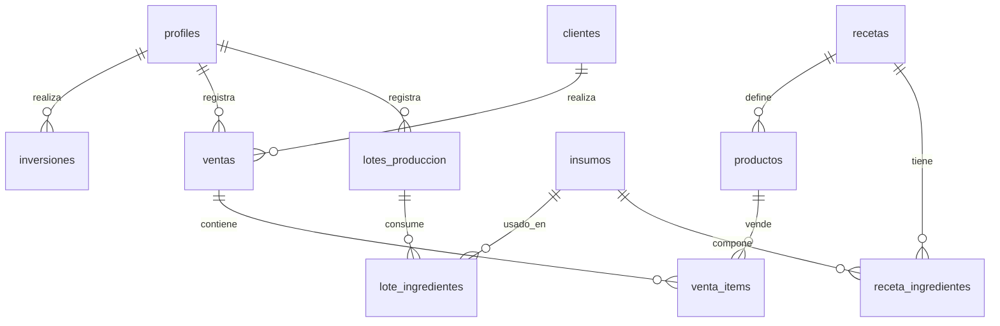

# Especificación Técnica y Arquitectura - Sistema "La casa cocina"

Este documento contiene la arquitectura de software, el diseño de la base de datos (esquema SQL) y las políticas de seguridad para el desarrollo del sistema de **"La casa cocina"** (pastas, empanadas y tartas congeladas). Su objetivo es garantizar una base de código limpia, escalable y costo $0 de infraestructura utilizando **Next.js** y **Supabase**.

---

## 1. Stack Tecnológico Elegido (Costo $0 USD)

*   **Frontend**: Next.js (React Framework, utilizando **App Router** para un renderizado híbrido y Middleware eficiente).
*   **Styling (CSS)**: TailwindCSS (Mobile-First responsive, optimizado para celulares de mostrador y cocina).
*   **Backend-as-a-Service**: Supabase.
    *   **Base de datos**: PostgreSQL (Base de datos relacional robusta).
    *   **Autenticación**: Supabase Auth (Manejo de sesiones, login por email/contraseña).
    *   **Seguridad**: Row Level Security (RLS) para proteger los datos en la base de datos.
*   **Hosting**: Vercel (Plan Hobby, permanente y gratuito, sin problemas de servidores que se duermen).

---

## 2. Modelo de Base de Datos (Esquema SQL de Postgres)

A continuación se detalla el esquema físico de tablas e índices para Supabase, optimizado para relaciones íntegras y velocidad de consulta.



### Script de Creación de Tablas (DDL)

```sql
-- Habilitar extensión UUID si no está activa
CREATE EXTENSION IF NOT EXISTS "uuid-ossp";

-- 1. Tabla de Perfiles de Usuario (Admin/Dueño)
CREATE TABLE profiles (
    id UUID REFERENCES auth.users ON DELETE CASCADE PRIMARY KEY,
    nombre VARCHAR(100) NOT NULL,
    created_at TIMESTAMP WITH TIME ZONE DEFAULT TIMEZONE('utc'::text, NOW()) NOT NULL
);

-- 2. Tabla de Insumos (Materia Prima / Envases)
CREATE TABLE insumos (
    id UUID DEFAULT uuid_generate_v4() PRIMARY KEY,
    nombre VARCHAR(150) NOT NULL,
    unidad_medida VARCHAR(10) NOT NULL CHECK (unidad_medida IN ('g', 'ml', 'u')),
    costo_bruto_unitario DECIMAL(12, 4) NOT NULL DEFAULT 0.0000,
    stock_actual DECIMAL(12, 2) NOT NULL DEFAULT 0.00,
    stock_minimo DECIMAL(12, 2) DEFAULT 0.00,
    created_at TIMESTAMP WITH TIME ZONE DEFAULT TIMEZONE('utc'::text, NOW()) NOT NULL
);

-- 3. Tabla de Recetas (Elaboración Base de Sorrentino/Empanada individual)
CREATE TABLE recetas (
    id UUID DEFAULT uuid_generate_v4() PRIMARY KEY,
    nombre VARCHAR(150) NOT NULL,
    porciones_rendimiento INTEGER NOT NULL DEFAULT 1 CHECK (porciones_rendimiento > 0),
    costo_envase DECIMAL(10, 2) NOT NULL DEFAULT 0.00,
    created_at TIMESTAMP WITH TIME ZONE DEFAULT TIMEZONE('utc'::text, NOW()) NOT NULL
);

-- 4. Tabla de Relación Receta - Ingredientes (Con mermas)
CREATE TABLE receta_ingredientes (
    id UUID DEFAULT uuid_generate_v4() PRIMARY KEY,
    receta_id UUID REFERENCES recetas(id) ON DELETE CASCADE NOT NULL,
    insumo_id UUID REFERENCES insumos(id) ON DELETE RESTRICT NOT NULL,
    peso_limpio DECIMAL(10, 2) NOT NULL CHECK (peso_limpio > 0),
    porcentaje_merma DECIMAL(5, 2) NOT NULL DEFAULT 0.00 CHECK (porcentaje_merma >= 0 AND porcentaje_merma < 100),
    UNIQUE(receta_id, insumo_id)
);

-- 5. Tabla de Productos de Venta (Múltiplos: Docenas, Cajas, Porciones)
CREATE TABLE productos (
    id UUID DEFAULT uuid_generate_v4() PRIMARY KEY,
    nombre VARCHAR(150) NOT NULL,
    receta_id UUID REFERENCES recetas(id) ON DELETE RESTRICT NOT NULL,
    unidad_venta VARCHAR(50) NOT NULL, -- ej. 'docena', 'porcion (8u)', 'kilo'
    cantidad_unidades_base INTEGER NOT NULL CHECK (cantidad_unidades_base > 0), -- ej. 12, 8, 1
    precio_lista DECIMAL(10, 2) NOT NULL CHECK (precio_lista >= 0),
    created_at TIMESTAMP WITH TIME ZONE DEFAULT TIMEZONE('utc'::text, NOW()) NOT NULL
);

-- 6. Tabla de Clientes (Solo Nombre/Apellido obligatorio)
CREATE TABLE clientes (
    id UUID DEFAULT uuid_generate_v4() PRIMARY KEY,
    nombre_apellido VARCHAR(150) NOT NULL,
    telefono VARCHAR(30),
    notas TEXT,
    created_at TIMESTAMP WITH TIME ZONE DEFAULT TIMEZONE('utc'::text, NOW()) NOT NULL
);

-- 7. Tabla de Lotes de Producción (Cocina diaria)
CREATE TABLE lotes_produccion (
    id UUID DEFAULT uuid_generate_v4() PRIMARY KEY,
    fecha DATE NOT NULL DEFAULT CURRENT_DATE,
    receta_id UUID REFERENCES recetas(id) ON DELETE RESTRICT NOT NULL,
    cantidad_producida INTEGER NOT NULL CHECK (cantidad_producida > 0),
    registrado_por UUID REFERENCES profiles(id) ON DELETE SET NULL,
    created_at TIMESTAMP WITH TIME ZONE DEFAULT TIMEZONE('utc'::text, NOW()) NOT NULL
);

-- 8. Tabla de Ingredientes Consumidos por Lote (Historial de mermas reales editadas)
CREATE TABLE lote_ingredientes (
    id UUID DEFAULT uuid_generate_v4() PRIMARY KEY,
    lote_id UUID REFERENCES lotes_produccion(id) ON DELETE CASCADE NOT NULL,
    insumo_id UUID REFERENCES insumos(id) ON DELETE RESTRICT NOT NULL,
    cantidad_bruta_consumida DECIMAL(12, 2) NOT NULL CHECK (cantidad_bruta_consumida >= 0),
    UNIQUE(lote_id, insumo_id)
);

-- 9. Tabla de Ventas
CREATE TABLE ventas (
    id UUID DEFAULT uuid_generate_v4() PRIMARY KEY,
    fecha TIMESTAMP WITH TIME ZONE DEFAULT TIMEZONE('utc'::text, NOW()) NOT NULL,
    cliente_id UUID REFERENCES clientes(id) ON DELETE RESTRICT NOT NULL,
    estado_cobro VARCHAR(20) NOT NULL CHECK (estado_cobro IN ('Cobrada', 'Pendiente')),
    registrado_por UUID REFERENCES profiles(id) ON DELETE SET NULL
);

-- 10. Tabla de Ítems de la Venta
CREATE TABLE venta_items (
    id UUID DEFAULT uuid_generate_v4() PRIMARY KEY,
    venta_id UUID REFERENCES ventas(id) ON DELETE CASCADE NOT NULL,
    producto_id UUID REFERENCES productos(id) ON DELETE RESTRICT NOT NULL,
    cantidad INTEGER NOT NULL CHECK (cantidad > 0),
    precio_cobrado_real DECIMAL(10, 2) NOT NULL CHECK (precio_cobrado_real >= 0)
);

-- 11. Tabla de Inversiones (Freezers, maquinaria)
CREATE TABLE inversiones (
    id UUID DEFAULT uuid_generate_v4() PRIMARY KEY,
    nombre VARCHAR(150) NOT NULL,
    monto DECIMAL(12, 2) NOT NULL CHECK (monto > 0),
    vida_util_anios INTEGER NOT NULL CHECK (vida_util_anios > 0),
    fecha_compra DATE NOT NULL DEFAULT CURRENT_DATE,
    registrado_por UUID REFERENCES profiles(id) ON DELETE SET NULL,
    created_at TIMESTAMP WITH TIME ZONE DEFAULT TIMEZONE('utc'::text, NOW()) NOT NULL
);
```

---

## 3. Seguridad y Control de Acceso (Supabase RLS)

Para evitar que cualquier persona ajena al negocio acceda a la base de datos pública, se aplican políticas de **Row Level Security (RLS)** a nivel de base de datos.

### Reglas RLS:
1.  **Habilitar RLS** en todas las tablas:
    ```sql
    ALTER TABLE profiles ENABLE ROW LEVEL SECURITY;
    ALTER TABLE insumos ENABLE ROW LEVEL SECURITY;
    -- (repetir para todas las tablas)
    ```
2.  **Políticas de Acceso**:
    Dado que es un negocio familiar administrado por los dueños, se definen políticas de acceso para **usuarios autenticados**:
    ```sql
    -- Ejemplo para tabla insumos: solo usuarios logueados pueden ver y modificar
    CREATE POLICY "Permitir todo a usuarios autenticados" 
    ON insumos 
    FOR ALL 
    TO authenticated 
    USING (true) 
    WITH CHECK (true);
    ```
    Esto bloquea al 100% las peticiones anónimas (`anon` key de Supabase sin token de sesión).

---

## 4. Protección de Rutas en Next.js (Middleware)

El inicio de sesión se valida a nivel de servidor (Edge) para impedir que un usuario no logueado cargue el frontend de la aplicación.

### Ejemplo de Lógica de Middleware (`src/middleware.js`):

```javascript
import { createMiddlewareClient } from '@supabase/auth-helpers-nextjs';
import { NextResponse } from 'next/server';

export async function middleware(req) {
  const res = NextResponse.next();
  const supabase = createMiddlewareClient({ req, res });

  // Obtener la sesión actual del usuario
  const { data: { session } } = await supabase.auth.getSession();

  // Si no hay sesión y no está intentando entrar al login, redireccionar a /login
  if (!session && !req.nextUrl.pathname.startsWith('/login')) {
    const redirectUrl = req.nextUrl.clone();
    redirectUrl.pathname = '/login';
    return NextResponse.redirect(redirectUrl);
  }

  // Si hay sesión e intenta ir al login, redireccionar al dashboard
  if (session && req.nextUrl.pathname.startsWith('/login')) {
    const redirectUrl = req.nextUrl.clone();
    redirectUrl.pathname = '/';
    return NextResponse.redirect(redirectUrl);
  }

  return res;
}

export const config = {
  matcher: ['/((?!api|_next/static|_next/image|favicon.ico).*)'],
};
```

---

## 5. Diseño e Interfaz Mobile-First (Pantallas Clave en Celular)

La UI se estructurará mediante layouts responsivos con botones grandes y listados limpios.

### Vistas principales de la aplicación:

1.  **Dashboard (Resumen del Día)**:
    *   Tarjetas con: Ventas Cobradas del mes, Cuentas Pendientes de cobro y Ganancia Neta Real.
    *   Botón flotante gigante `+ Registrar Venta` y `+ Registrar Cocina`.
    *   Tabla de amortización automática de costos fijos integrada en el total mensual.
2.  **Sección Insumos**:
    *   Buscador rápido de ingredientes.
    *   Listado simple indicando stock físico y precio actual.
    *   Botón para registrar compra (pide precio total y cantidad comprada para actualizar el costo promedio al instante).
3.  **Sección Recetas y Productos**:
    *   Carga de Receta (Nombre, Rendimiento en u, ingredientes con peso limpio y % merma).
    *   Carga de Producto (Asocia receta, selecciona unidad como docena o kilo, define multiplicador y precio de venta de lista).
4.  **Registrar Cocina (Paso 1 del Stock)**:
    *   Pantalla tipo "formulario rápido" para indicar qué lote se cocinó.
    *   Muestra los ingredientes que se van a descontar teóricamente en una lista editable. El usuario corrige los gramos antes de guardar.
5.  **Mostrador de Ventas (Paso 2 del Stock)**:
    *   Botones con fotos o íconos grandes de productos de pastas y empanadas.
    *   Selector de cantidad `+` y `-`.
    *   Buscador rápido de Cliente para asociar la venta (si está pendiente).
    *   Interruptor de estado: `[Cobrada / Pendiente]`.
6.  **Sección Inversiones**:
    *   Listado de maquinaria comprada, su valor y depreciación mensual automática calculada.
